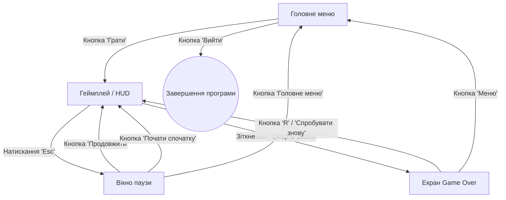

# Практична робота №8
**Тема:** Проєктування інтерфейсу користувача[cite: 3]
**Результат:** Figma-прототип програмного продукту та опис UI/UX[cite: 3]

---

### 1. Основні екрани та вікна системи

Для забезпечення зручного користувацького досвіду інтерфейс розділено на 4 основні екрани/стани:

1. **Головне меню (Main Menu Screen):**
   * Назва проєкту («Snake Roguelite»).
   * Відображення збереженого глобального рекорду («High Score: X»)[cite: 9].
   * Кнопка «Грати» (Play)[cite: 9].
   * Кнопка виходу з гри (Quit).

2. **Ігровий інтерфейс (Gameplay HUD):**
   * Верхня панель стану: лічильник поточного рахунку («Score: X») та рекорд («Best: X»)[cite: 8, 9].
   * Індикатор активних модифікаторів: іконка бафу та таймер залишкового часу дії[cite: 8, 9].
   * Ігрове поле: прямокутна сітка з межами арени, змійкою та об'єктами[cite: 4, 8].

3. **Вікно паузи (Pause Overlay):**
   * Напівпрозоре затемнення ігрового поля при натисканні клавіші Esc.
   * Кнопка «Продовжити» (Resume).
   * Кнопка «Почати спочатку» (Restart).
   * Кнопка виходу в головне меню (Main Menu).

4. **Екран завершення гри (Game Over Screen):**
   * Заголовок поразки («Game Over»)[cite: 8, 9].
   * Підсумковий результат поточного забігу («Final Score: X»)[cite: 8, 9].
   * Повідомлення про встановлення нового рекорду («New Record!»), якщо рахунок перевищено[cite: 9].
   * Підказка або кнопка «Спробувати знову (R)» (Retry)[cite: 9].
   * Кнопка виходу в меню (Menu).

---

### 2. Схема переходів та навігації між екранами

---

### 3. Основні користувацькі сценарії взаємодії (User Flows)

#### Сценарій 1: Запуск швидкого забігу
1. Користувач запускає гру та потрапляє на екран Головного меню[cite: 8, 9].
2. Переглядає зафіксований раніше рекорд[cite: 8, 9].
3. Натискає кнопку «Грати»[cite: 9].
4. Відбувається перехід на екран геймплею, запускається переміщення змійки[cite: 9].

#### Сценарій 2: Взаємодія під час гри та Game Over
1. Під час гри користувач бачить оновлення рахунку на верхній панелі при збиранні їжі[cite: 8, 9].
2. При підбиранні бонусу з'являється плашка активного модифікатора з таймером зворотного відліку[cite: 8, 9].
3. У разі зіткнення зі стіною або тілом відкривається екран Game Over із підсумковими балами[cite: 8, 9].
4. Гравець тисне кнопку «Спробувати знову» або клавішу R для миттєвого старту нового забігу[cite: 9].

---

### 4. Прототип інтерфейсу у Figma

* Посилання на Figma-макет: [Вставити лінк на ваш макет у Figma][cite: 3]
* Концепція макетів екранів:
  * **Головне меню:** назва по центру, під нею найкращий результат та кнопки запуску й виходу[cite: 9].
  * **Геймплей (HUD):** мінімалістична верхня плашка зі значеннями Score / Best та ігрове поле по центру[cite: 8, 9].
  * **Game Over:** модальне вікно з виведенням фінального рахунку та кнопкою швидкого перезапуску[cite: 8, 9].

---

### 5. Перевірка відповідності інтерфейсу вимогам

| Вимога зі специфікації | Реалізація в інтерфейсі | Статус |
| :--- | :--- | :---: |
| **Відображення очок у реальному часі**[cite: 8, 9] | Текстовий блок Score у верхній частині екрана (HUD)[cite: 9] | Відповідає |
| **Фіксація та перегляд рекорду**[cite: 8, 9] | Поле High Score у головному меню та під час забігу[cite: 9] | Відповідає |
| **Індикація стану поразки**[cite: 8, 9] | Екран Game Over із фінальним результатом[cite: 8, 9] | Відповідає |
| **Швидкий перезапуск**[cite: 8, 9] | Кнопка «Спробувати знову» та дія на клавішу R[cite: 9] | Відповідає |
| **Відображення модифікаторів**[cite: 8, 9] | Індикатор із таймером активного бафу[cite: 8, 9] | Відповідає |
