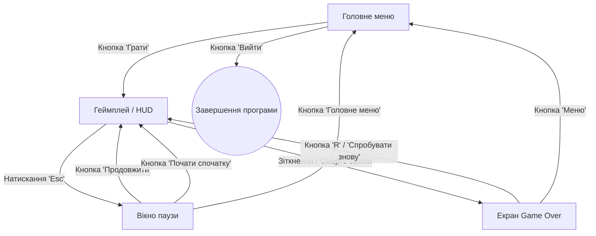

# Практична робота №8
**Тема:** Проєктування інтерфейсу користувача
**Результат:** Figma-прототип програмного продукту та опис UI/UX

---

### 1. Основні екрани та вікна системи

Для забезпечення зручного користувацького досвіду інтерфейс розділено на 4 основні екрани/стани:

1. **Головне меню (Main Menu Screen):**
   * Назва проєкту («Snake Roguelite»).
   * Відображення збереженого глобального рекорду («High Score: X»).
   * Кнопка «Грати» (Play).
   * Кнопка виходу з гри (Quit).

2. **Ігровий інтерфейс (Gameplay HUD):**
   * Верхня панель стану: лічильник поточного рахунку («Score: X») та рекорд («Best: X»).
   * Індикатор активних модифікаторів: іконка бафу та таймер залишкового часу дії.
   * Ігрове поле: прямокутна сітка з межами арени, змійкою та об'єктами.

3. **Вікно паузи (Pause Overlay):**
   * Напівпрозоре затемнення ігрового поля при натисканні клавіші Esc.
   * Кнопка «Продовжити» (Resume).
   * Кнопка «Почати спочатку» (Restart).
   * Кнопка виходу в головне меню (Main Menu).

4. **Екран завершення гри (Game Over Screen):**
   * Заголовок поразки («Game Over»).
   * Підсумковий результат поточного забігу («Final Score: X»).
   * Повідомлення про встановлення нового рекорду («New Record!»), якщо рахунок перевищено.
   * Підказка або кнопка «Спробувати знову (R)» (Retry).
   * Кнопка виходу в меню (Menu).

---

### 2. Схема переходів та навігації між екранами

---

### 3. Основні користувацькі сценарії взаємодії (User Flows)

#### Сценарій 1: Запуск швидкого забігу
1. Користувач запускає гру та потрапляє на екран Головного меню.
2. Переглядає зафіксований раніше рекорд.
3. Натискає кнопку «Грати».
4. Відбувається перехід на екран геймплею, запускається переміщення змійки.

#### Сценарій 2: Взаємодія під час гри та Game Over
1. Під час гри користувач бачить оновлення рахунку на верхній панелі при збиранні їжі.
2. При підбиранні бонусу з'являється плашка активного модифікатора з таймером зворотного відліку.
3. У разі зіткнення зі стіною або тілом відкривається екран Game Over із підсумковими балами.
4. Гравець тисне кнопку «Спробувати знову» або клавішу R для миттєвого старту нового забігу.

---

### 4. Прототип інтерфейсу у Figma

* Figma-макет:

* Концепція макетів екранів:
  * **Головне меню:** назва по центру, під нею найкращий результат та кнопки запуску й виходу.
  * **Геймплей (HUD):** мінімалістична верхня плашка зі значеннями Score / Best та ігрове поле по центру.
  * **Game Over:** модальне вікно з виведенням фінального рахунку та кнопкою швидкого перезапуску.

---

### 5. Перевірка відповідності інтерфейсу вимогам

| Вимога зі специфікації | Реалізація в інтерфейсі | Статус |
| :--- | :--- | :---: |
| **Відображення очок у реальному часі** | Текстовий блок Score у верхній частині екрана (HUD) | Відповідає |
| **Фіксація та перегляд рекорду** | Поле High Score у головному меню та під час забігу | Відповідає |
| **Індикація стану поразки** | Екран Game Over із фінальним результатом | Відповідає |
| **Швидкий перезапуск** | Кнопка «Спробувати знову» та дія на клавішу R | Відповідає |
| **Відображення модифікаторів** | Індикатор із таймером активного бафу | Відповідає |
